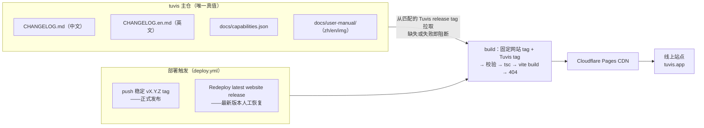

# 兔维斯官网（tuvis-website）

> 你的桌面多 Agent 指挥台——官网与交互演示。

**线上**：<https://tuvis.app/zh>

技术栈：Vite 6 · React 19 · TypeScript strict · Tailwind CSS v4 · GitHub Pages（子路径部署）· 中英双语 · 全站零追踪。

## 兔维斯世界专区

- 专题页：`/zh/world`、`/en/world`。W-01～W-06 六段图文：主视觉、角色、四装备图鉴、回路城设定、三篇故事档案、工坊入口。
- 工坊：`/zh/world/workshop`、`/en/world/workshop`。固定斜俯视房间，点击地面移动、点击物件走近后互动；完成 Bug Buster 三模块收集、能源匣维修、拖拽/点击组装、装备架陈列，进度保存在浏览器 localStorage。
- 素材与坐标唯一来源：`tuvis-world/05_handoff/v1/`（manifest / scene / content）。`node scripts/import-world-pack.mjs` 校验 SHA-256 后复制到 `public/world/v1/`，运行时不依赖生图、模型 API 或额外服务。
- 世界正文按中文交付；`/en` 路径保留英文导航与界面，并标注内容语言。界面文案由 `src/i18n/` 提供，中英键集保持 parity。
- 验收记录与截图：`docs/qa/tuvis-world-desktop.md`、`docs/qa/screenshots/`。浏览器复验脚本：`node scripts/qa-cdp.mjs`（只读四路由探针）与 `node scripts/qa-world-interactions.mjs`（真实鼠标主链路、取消、双输入、缩放、深链接）。两者需要先启动 `pnpm preview --host 127.0.0.1 --port 4173` 与带 `--remote-debugging-port=9222` 的 Chrome。
- 背景音乐：Sappheiros – Universe（CC BY 3.0，经 BreakingCopyright）；工坊右上角可开关，来源与署名见 `public/world/audio/README.md`。

## 本地开发

```bash
pnpm install
pnpm dev          # 零网络、秒开（内容用仓内副本）——macOS 可双击 start-dev.command
```

| 命令 | 网络 | 用途 |
|---|---|---|
| `pnpm dev` | 零网络 | 日常起服务 |
| `pnpm dev:sync` | 先同步（15s 预算）再起 | 带主仓最新内容起服务 |
| `pnpm sync` | 手动同步 | 立刻拉主仓最新文档/日志/矩阵，失败自动用副本 |
| `pnpm build` | 同步 + 构建 | 与 CI 同一条命令，本地仅预览验证 |
| `pnpm test` | — | vitest（i18n parity / 零 Han 门禁 / tokens / player / ledger / 下载 / 同步闸门 / 兔维斯世界） |
| `pnpm sync:changelog` / `pnpm sync:manual` | 手动 | 单独同步某一类内容 |

### macOS 一键启动 / 关闭

双击 `start-dev.command` 启动服务并自动打开兔维斯世界页面；双击 `stop-dev.command` 关闭。

命令行等价：

```bash
./scripts/dev-start.sh
./scripts/dev-stop.sh
```

服务地址：<http://127.0.0.1:5173/zh/world>。首次运行若没有 `node_modules`，脚本会自动用 `npx pnpm@10.20.0` 安装依赖；PID 与日志写在 `.dev-server.pid` / `.dev-server.log`。

## 更新机制

站点内容（更新日志 / 兼容矩阵 / 用户手册）的唯一真值在 **tuvis 主仓**（`jarvislee90s-dot/tuvis`）。本地预览可以回退仓内副本；正式发布构建固定读取与网站 tag 同名的 Tuvis tag，来源缺失或校验失败就阻断部署。



> 注意：**push main 只运行 CI / 存档、永不部署**。只有正式稳定 tag `vX.Y.Z` 发布；同版本恢复只能通过专用 workflow 重发最新 tag（详见 [docs/deploy/README.md](docs/deploy/README.md)）。

### 同步源 → 前端消费位置

| 同步源（tuvis 主仓） | 构建产物 | 前端消费位置 |
|---|---|---|
| `CHANGELOG.md`（纯中文） | `src/content/changelog.json` | ① 首页 Hero 徽章 `vX.Y.Z · 开源` ② /zh/changelog 页 ③ 演示手机看板品牌行 ④ 首页「关于」窗版本号 |
| `CHANGELOG.en.md`（纯英文） | `src/content/changelog.en.json` | /en/changelog 页（只列已完成英文翻译的版本，不回落中文；两版彻底分家） |
| `docs/capabilities.json` | `src/content/capabilities.json` | 首页八工具兼容矩阵（经键名/覆盖/取值域三重闸门校验） |
| `docs/user-manual/`（45 文件） | `public/manual/` | /docs 全部 13 篇手册（中英）与配图 |

另有**运行时动态**一处：免费下载按钮点击时实时查 Releases API，安装包永远指向最新 release（不经构建）。

## 发版

```bash
pnpm release:website vX.Y.Z                       # 仅从干净且同步的 main 创建正式 tag 并发布
```

- Tuvis 主仓必须先有同名正式 tag；命令会检查两仓 tag、版本递增、工作树干净和 `main` 同步，然后把网站 tag 推到当前 `origin/main` SHA。
- 普通 `main` push、checkpoint 和定时任务不部署；相同版本重新发布通过 Actions 的 **Redeploy latest website release**，且只允许最新稳定 tag。
- 首次上线或排障：见 [docs/deploy/README.md](docs/deploy/README.md)
- 项目目录里说「**发版**」即可触发 `tuvis-release` 技能代跑全流程（提交收尾 → 推 main → 问版本号 → 打 tag → 盯构建 → 验证线上）

## 结构速览

```
tuvis-website/
├── SPEC.md                  # 建站规格（v1.5，需求与决策记录）
├── docs/deploy/             # 正式发布与 Cloudflare Pages 部署说明
├── docs/design/             # 演示/文档参考稿（remote-ui 定稿、p9~p13 参考图）
├── docs/qa/                 # 兔维斯世界验收记录与真实浏览器截图
├── docs/superpowers/plans/  # P0~P13 与兔维斯世界计划、progress.md 全程记录
├── scripts/                 # 同步脚本（split-changelog / sync-user-manual）等
├── src/
│   ├── world/               # 兔维斯世界：专题内容、导航、工坊场景与 Bug Buster 主线
│   ├── home/                # 首页区块（Hero / 产品形态 / 矩阵 / 对比 / 关于+下载）
│   ├── demo/                # 交互演示引擎（四场景 + 剧本 player + 手机/终端仿真窗）
│   ├── pages/               # Home / Demo / Docs / Changelog
│   ├── content/             # 同步产物（changelog / capabilities / 手册索引）
│   └── i18n/                # 中英双语（397 键 parity 测试覆盖）
├── public/manual/           # 用户手册同步副本（离线兜底，入 git）
├── brand/                   # 品牌资产（红线：不可改）
└── legacy/                  # 旧草稿归档（红线：不可改）
```

## 琐碎备忘

- **生成物勿手改**：`src/content/*.json` 与 `public/manual/` 是构建同步产物，改动只会发生在 tuvis 主仓对应文件。
- **部署仅由 `v*` tag 触发**：push main 永不上线（发版模型是刻意的）。
- **托管在 Cloudflare Pages（2026-10 起）**：secrets `CLOUDFLARE_API_TOKEN` / `CLOUDFLARE_ACCOUNT_ID` 驱动 wrangler 直传；旧 GitHub Pages 站点已停更，验证新站后在仓库 Settings → Pages 关停。
- **仓库改名只影响 git remote**：线上地址已是自有域名 tuvis.app，与仓库名彻底解耦。
- **首访语言分流（W1/W2）**：`/`、未知路径与非法 lang 段按「手动偏好 → 浏览器语言」归流（zh* → 中文，其余 → 英文）；偏好存 localStorage `tuvis-lang-pref`，**仅站内手动切换写入**，自动检测结果不落盘；合法 /zh /en 深链与 tuvis-redirect 回放永不改跳（W3）。
- **`SITE_DISPATCH_PAT` 已不再需要**：网站不接受 Tuvis 仓的 `repository_dispatch` 部署通知；旧 notify workflow 与 secret 可从 Tuvis 仓清理。
- **同步脚本带 `--use-system-ca`**：本机代理会自签 TLS 证书，Node 需系统 CA 才能连 GitHub；新脚本涉及网络时记得同样处理。
- **质量基线**：vitest（含兔维斯世界、中英 i18n parity 与零 Han 门禁）；构建含 tsc 严格检查；Lighthouse a11y ≥ 95 不回退。
- **红线**：`brand/`、`legacy/` 不可改；`SPEC.md`原则上不改，部署决策经用户批准后可同步；全站零追踪脚本；下载 API 失败回退 Releases 列表页。
- **演示数据 tuvis 化**：真实截图里的项目名/域名/会话内容一律不入站，演示语境全部模拟为 tuvis 生态。
- **首页「关于」窗的当前版本刻意比最新 release 旧一版**（取 changelog 倒数第二条），保持「检测到新版本」的演示语义。
- **Git 行尾 CRLF warning 无害**：Windows + autocrlf 的常规提示。

## 品牌资产速览（2026-10-10 定稿：生图路线 v3，无框整块渐变玻璃目镜）

| 形态 | 文件 |
|---|---|
| 应用图标 · 深色（定稿） | `brand/final/extracted/13-appicon-dark.png` @837 |
| 应用图标 · 浅色（定稿） | `brand/final/extracted/14-appicon-light.png` @874 |
| Hero 主立绘（透明底） | `brand/final/extracted/21-hero-cutout.png` |
| 状态三态立绘（绿/黄/红） | `brand/final/extracted/10~12-state-*.png` |
| 托盘胡萝卜三态 | `brand/final/extracted/15~17-tray-*.png` |
| 品牌系统规范 | `brand/final/Tuvis Mascot & Brand System v1.0.txt` |
| 图标配色规格 | `brand/final/logo/versions/05-aigen/COLOR-SPEC.md` |

## 预览旧草稿（可选）

```bash
cd legacy && python -m http.server 8080   # http://localhost:8080
```
